# 게임룸

**브라우저에서 즐기는 Web Games 13종.**

[로컬 게임룸 열기](http://127.0.0.1:8810/) · [실행 방법](#실행) · [개발과 검증](#개발과-검증) · [출처](docs/PROVENANCE.md)

이 저장소는 **Web Games** 모음입니다. **Phone Controller Games**는 별도 Render 프로젝트에서 관리합니다.

## 게임 모음

아래 **로컬 플레이** 링크는 `npm run dev` 실행 후 이 컴퓨터에서 열립니다. GitHub에서는 이미지·소스·안내 문서를 볼 수 있으며, 공개 플레이 주소는 배포를 확인한 뒤 추가합니다.

<table>
  <tr>
    <td width="33%" align="center" valign="top">
      <a href="public/art/previews/sushi.png">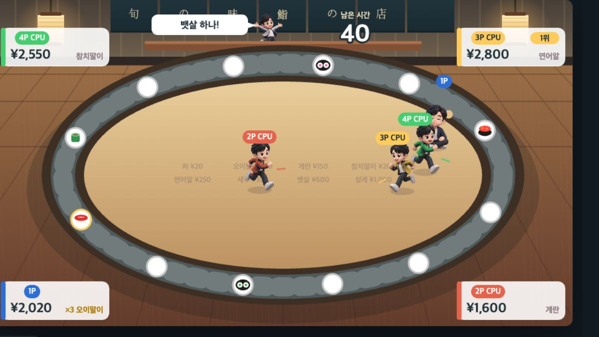</a><br>
      <strong>초밥 뷔페</strong><br>
      <sub>1–4인 · 한 키보드 · 초밥 파티</sub><br>
      <a href="http://127.0.0.1:8810/stadium/games/sushi.html">로컬 플레이</a> · <a href="public/stadium/games/sushi.html">소스</a>
    </td>
    <td width="33%" align="center" valign="top">
      <a href="public/art/previews/says.png">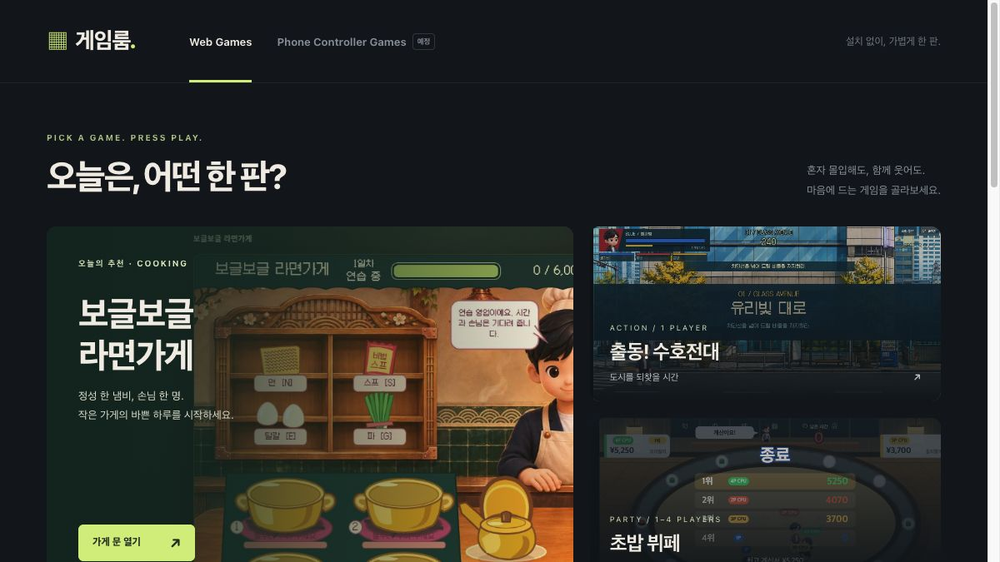</a><br>
      <strong>칠판 기억왕</strong><br>
      <sub>1–4인 · 한 키보드 · 기억력</sub><br>
      <a href="http://127.0.0.1:8810/stadium/games/says.html">로컬 플레이</a> · <a href="public/stadium/games/says.html">소스</a>
    </td>
    <td width="33%" align="center" valign="top">
      <a href="public/art/previews/harden.png">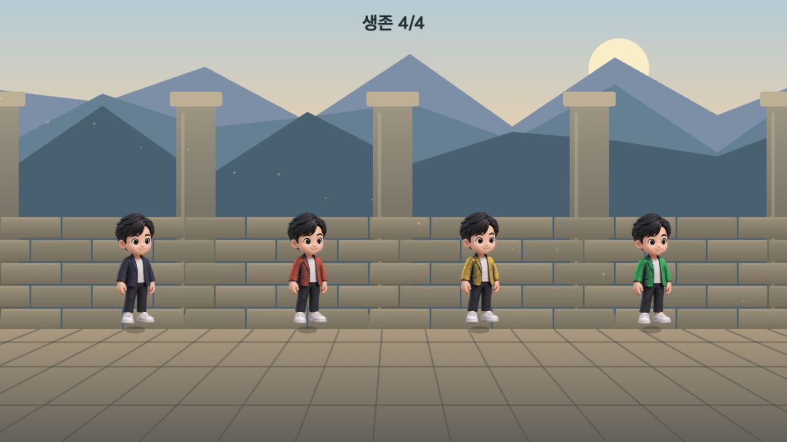</a><br>
      <strong>딱딱하게!</strong><br>
      <sub>1–4인 · 한 키보드 · 타이밍</sub><br>
      <a href="http://127.0.0.1:8810/stadium/games/harden.html">로컬 플레이</a> · <a href="public/stadium/games/harden.html">소스</a>
    </td>
  </tr>
  <tr>
    <td width="33%" align="center" valign="top">
      <a href="public/art/previews/stampede.png">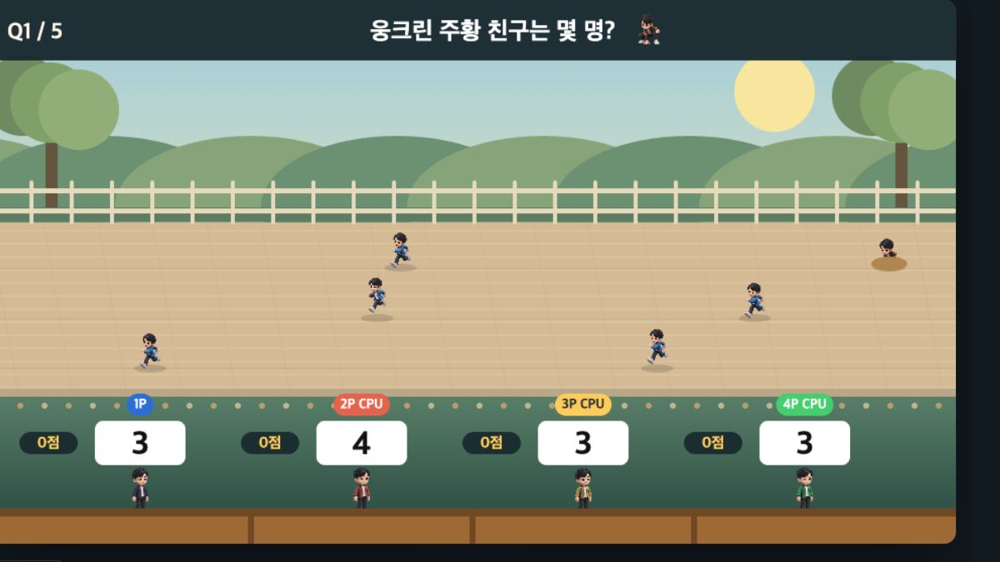</a><br>
      <strong>친구 세기</strong><br>
      <sub>1–4인 · 한 키보드 · 관찰력</sub><br>
      <a href="http://127.0.0.1:8810/stadium/games/stampede.html">로컬 플레이</a> · <a href="public/stadium/games/stampede.html">소스</a>
    </td>
    <td width="33%" align="center" valign="top">
      <a href="public/art/previews/crossroad.png">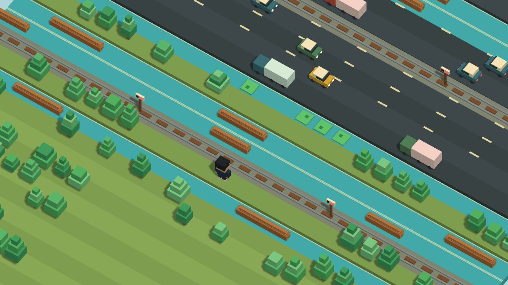</a><br>
      <strong>길 건너 한 판</strong><br>
      <sub>1인 · 길 건너기</sub><br>
      <a href="http://127.0.0.1:8810/crossroad/">로컬 플레이</a> · <a href="public/crossroad/">소스</a> · <a href="public/crossroad/README.md">안내</a>
    </td>
    <td width="33%" align="center" valign="top">
      <a href="public/art/previews/stairs.png"></a><br>
      <strong>끝없는 계단</strong><br>
      <sub>1인 · 계단 오르기</sub><br>
      <a href="http://127.0.0.1:8810/stairs/">로컬 플레이</a> · <a href="public/stairs/">소스</a> · <a href="public/stairs/README.md">안내</a>
    </td>
  </tr>
  <tr>
    <td width="33%" align="center" valign="top">
      <a href="public/art/previews/platformer.png">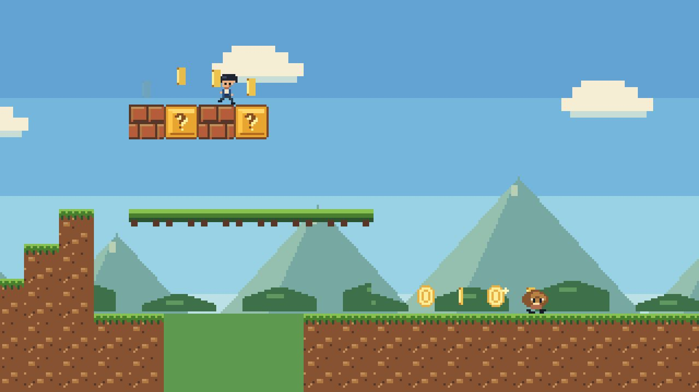</a><br>
      <strong>구름길 어드벤처</strong><br>
      <sub>1인 · 횡스크롤</sub><br>
      <a href="http://127.0.0.1:8810/platformer/">로컬 플레이</a> · <a href="public/platformer/">소스</a> · <a href="public/platformer/README.md">안내</a>
    </td>
    <td width="33%" align="center" valign="top">
      <a href="public/art/previews/ramen.png">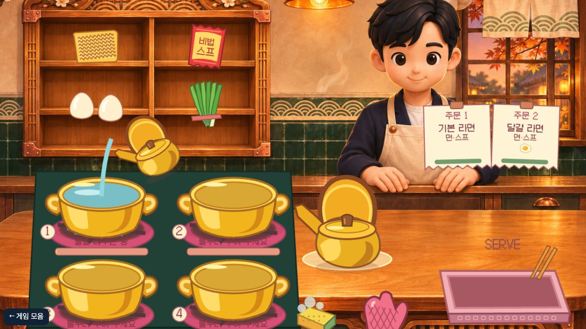</a><br>
      <strong>보글보글 라면가게</strong><br>
      <sub>1인 · 요리</sub><br>
      <a href="http://127.0.0.1:8810/ramen/">로컬 플레이</a> · <a href="sources/ramen/src/">소스</a> · <a href="sources/ramen/README.md">안내</a>
    </td>
    <td width="33%" align="center" valign="top">
      <a href="public/art/previews/rangers.png">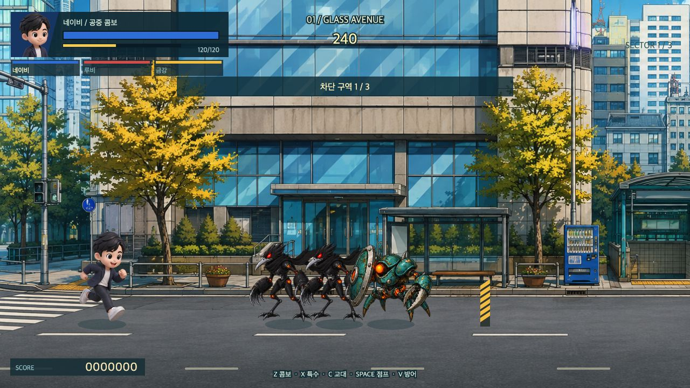</a><br>
      <strong>출동! 수호전대</strong><br>
      <sub>1인 · 태그 액션</sub><br>
      <a href="http://127.0.0.1:8810/rangers/">로컬 플레이</a> · <a href="sources/rangers/src/">소스</a> · <a href="sources/rangers/README.md">안내</a>
    </td>
  </tr>
  <tr>
    <td width="33%" align="center" valign="top">
      <a href="public/art/previews/ringout.png">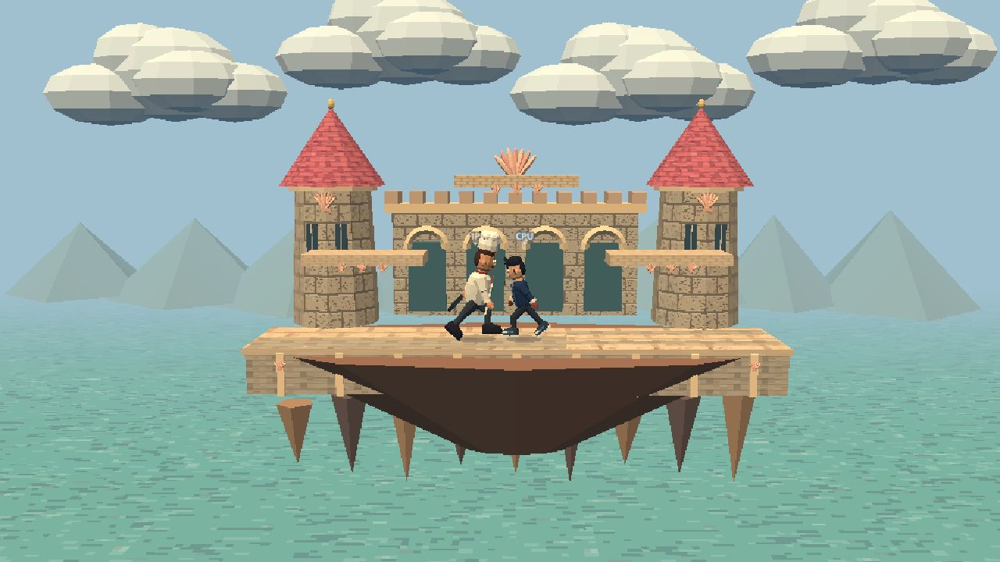</a><br>
      <strong>링아웃</strong><br>
      <sub>1P 대 CPU · 3D 대전</sub><br>
      <a href="http://127.0.0.1:8810/ringout/">로컬 플레이</a> · <a href="sources/ringout/src/">소스</a> · <a href="sources/ringout/README.md">안내</a>
    </td>
    <td width="33%" align="center" valign="top">
      <a href="public/art/previews/football-rescue.png">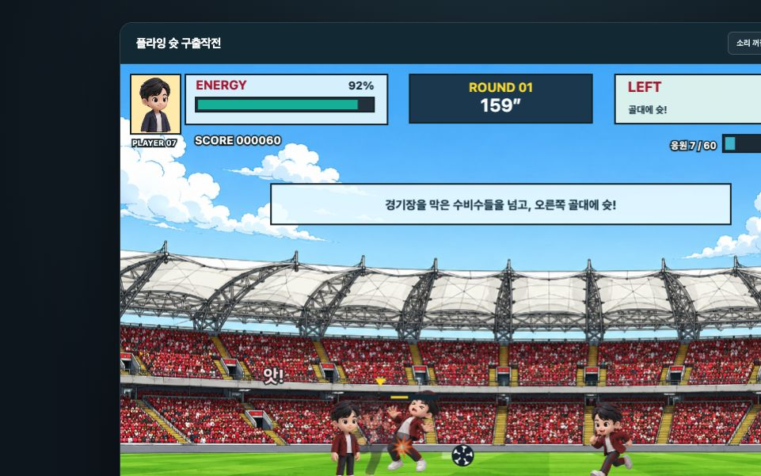</a><br>
      <strong>플라잉 슛 구출작전</strong><br>
      <sub>1인 · 축구 액션</sub><br>
      <a href="http://127.0.0.1:8810/football-rescue/">로컬 플레이</a> · <a href="sources/football-rescue/src/">소스</a> · <a href="sources/football-rescue/README.md">안내</a>
    </td>
    <td width="33%" align="center" valign="top">
      <a href="public/art/previews/gate-defense.png">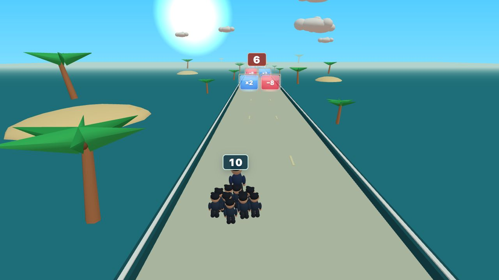</a><br>
      <strong>게이트 러시</strong><br>
      <sub>1인 · 러너</sub><br>
      <a href="http://127.0.0.1:8810/gate-defense/">로컬 플레이</a> · <a href="public/gate-defense/">소스</a>
    </td>
  </tr>
  <tr>
    <td colspan="3" align="center" valign="top">
      <a href="public/art/previews/chess.png">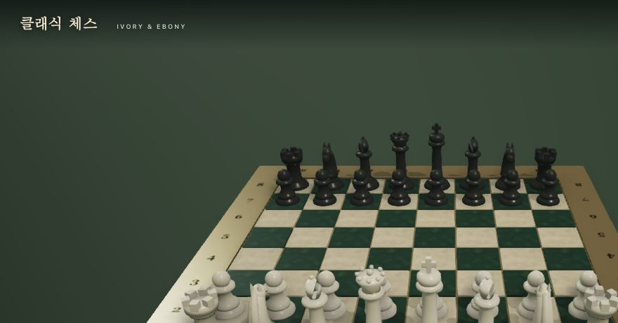</a><br>
      <strong>클래식 체스</strong><br>
      <sub>1인 · 보드게임</sub><br>
      <a href="http://127.0.0.1:8810/chess/">로컬 플레이</a> · <a href="public/chess/">소스</a>
    </td>
  </tr>
</table>

**함께 플레이:** 초밥 뷔페·칠판 기억왕·딱딱하게!·친구 세기는 한 키보드로 **1–4명**이 참여하며, 빈 자리는 CPU가 채웁니다. 링아웃은 **1P 대 CPU** 대전입니다. 게임패드는 지원하지 않으며, 터치 조작은 제공되는 게임에서 사용할 수 있습니다.

## 실행

Node.js **22.12 이상**과 Python 3가 필요합니다.

```sh
npm ci
npm run build
python3 scripts/portal.py
npm run dev
```

[게임룸 열기 → http://127.0.0.1:8810/](http://127.0.0.1:8810/)

홈에서는 선택한 카드 하나만 무음 자동 플레이를 보여 줍니다. 카드를 바꾸거나 페이지를 숨기면 미리보기를 정리하며, 동작 줄이기 설정과 일시정지 버튼을 지원합니다. 미리보기는 점수·설정을 저장하지 않습니다.

## 개발과 검증

<details>
<summary><strong>소스 구조 · 빌드 · 테스트</strong></summary>

| 경로 | 용도 |
| --- | --- |
| [public/](public/) | 게임룸과 실행 가능한 정적 게임 파일 |
| [sources/](sources/) | 라면가게·수호전대·플라잉 슛·링아웃의 편집용 Vite 소스와 테스트 |
| [scripts/build.mjs](scripts/build.mjs) | 위 네 게임을 빌드해 `public/`에 반영 |
| [scripts/portal.py](scripts/portal.py) | 홈 카드·[13종 카탈로그](public/catalog.json)·리소스 해시 갱신 |

```sh
# 워크스페이스 게임: 142개 테스트
npm test --workspaces --if-present

# 구름길 어드벤처: 40개 테스트
node --test public/platformer/tests/*.test.mjs

# 정적 파일 참조 확인
python3 scripts/check-assets.py
```

구름길 어드벤처는 실제 입력만으로 세 스테이지와 마지막 보스를 연속 완주하는 검증을 포함합니다. 링아웃은 모든 CPU 조합, 동시 마지막 KO, 432초 자동 미리보기를 검사합니다.

브라우저에서는 13개 자동 미리보기, 카드 전환·일시정지, 키보드 조작, 터치 UI와 화면 크기를 확인했습니다. 실제 휴대폰과 여러 사람이 동시에 누르는 키보드 하드웨어 검증은 별도로 진행합니다.

정적 호스팅의 배포 루트는 `public/`입니다. 공개 URL은 확인 후 이 문서에 추가합니다.

</details>

<details>
<summary><strong>출처 · 라이선스 · 캐릭터</strong></summary>

이식한 게임의 저장소·원본 커밋과 변경 내역은 [PROVENANCE](docs/PROVENANCE.md)에 기록했습니다. [MIT 라이선스](LICENSE)와 각 게임의 라이브러리·글꼴 고지를 보존합니다. 원본 문서와 이미지는 제작 이력으로 남아 있으며, 현재 화면과 다를 수 있습니다.

네이비는 캐릭터 참고 모델이며 모든 게임의 제목을 뜻하지 않습니다. 게임마다 다른 무대와 캐릭터를 사용합니다. 수호전대의 별도 캐릭터 원화는 [제작 기록](sources/rangers/docs/character-redesign.md), 링아웃의 사람 모델과 조작은 [게임 안내](sources/ringout/README.md)에서 확인할 수 있습니다.

Phone Controller Games와 Biohazard 통합은 별도 Render 프로젝트의 범위입니다. 벤치마크 게임과 선택하지 않은 Stadium·Party·Pocket 게임은 이 모음에 포함하지 않습니다.

</details>
