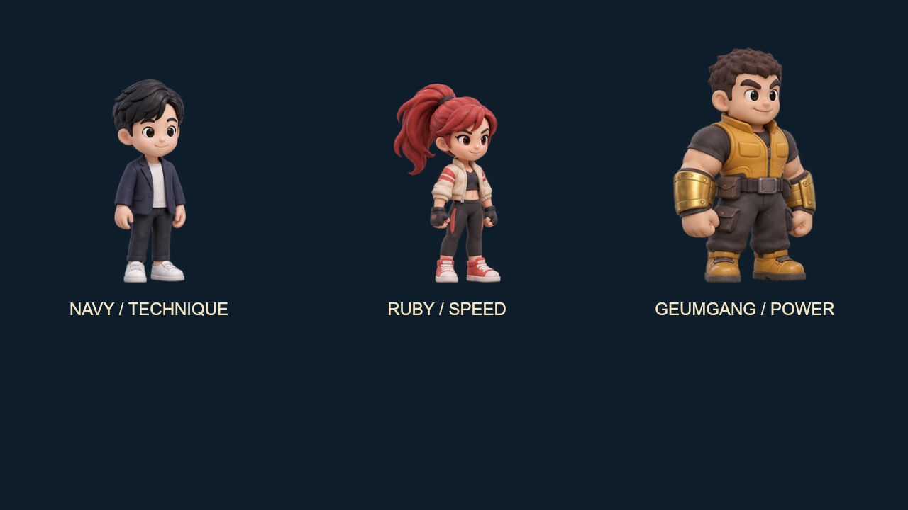

# 출동! 수호전대

세 대원을 교대하며 도시를 되찾는 2D 태그 액션 게임입니다. 아케이드 게임 모음의 `/rangers/`에서 실행됩니다.



## 세 대원

| 대원 | 외형과 역할 | 이동속도 / 공격 배율 | X 특수기 |
| --- | --- | --- | --- |
| 네이비 | 검은 옆가르마, 네이비 재킷. 균형 잡힌 공중 콤보형 | 270 / 1.0 | **상승권**: 적을 높이 띄우는 어퍼컷과 푸른 상승 궤적 |
| 루비 | 붉은 포니테일, 크림색 경량 재킷, 운동화. 빠른 돌진형 | 320 / 0.9 | **질풍각**: 긴 전방 돌진과 발차기 잔상 |
| 금강 | 짧은 머리, 넓은 체격, 금색 건틀릿과 중장갑. 넓은 공격 범위 | 235 / 1.2 | **진동권**: 낮게 내려찍는 동작과 지면 파열 |

세 캐릭터는 각각 별도 12포즈 투명 스프라이트를 사용합니다. 색상 변환으로 같은 캐릭터를 복제하지 않습니다. 이동속도, 공격 배율, 기력 소모, 타격 범위와 공격 판정은 기존 전투 밸런스를 유지했습니다. 금강의 장비와 방어 효과는 시각적 구분이며 별도의 방어 수치 보너스를 뜻하지 않습니다.

## 실행

Node.js 22.12 이상:

```sh
npm ci
npm run dev
npm test
npm run build
```

개발 주소는 `http://127.0.0.1:4203/`입니다. 같은 포트가 사용 중이면 종료합니다.

## 조작

| 입력 | 동작 |
| --- | --- |
| ← / → 또는 A / D | 이동 |
| Z → Z → Z | 주먹 · 연속 주먹 · 마무리 발차기 |
| Space 또는 W / 공중 Z | 점프 / 공중 발차기 |
| X / ↑ + X | 대원별 특수기 / 공통 상승권 |
| C | 살아 있는 다음 대원으로 교대 |
| V 또는 ↓ | 전방 방어 |
| 쓰러진 보스 앞 C · C | 협동 결정타 |
| Esc | 일시정지 / 계속 |

대원별 체력이 따로 유지됩니다. 특수기에는 기력이 필요하며 기본 공격과 방어로 충전합니다. 방패 병정은 정면 기본 공격에 강하고 상승권·진동권·공중 공격에 약합니다. 유리빛 대로, 운하 교차로, 중앙 관제탑을 진행하고 마지막에는 아케이드 로봇으로 합체합니다. 소리는 기본 OFF이며 직접 켰을 때만 합성 효과음을 사용합니다.

## 홈 카드 미리보기

`?preview=1`은 버튼과 메뉴를 숨긴 무음 자동전투 모드입니다. 실제 전투 엔진에 이동·공격·점프·교대 입력을 보내며 체력이나 공격력을 조작하지 않습니다. 24초마다 다음 대원을 선두로 다시 시작하고 패배·최종 승리도 자동으로 재시작합니다. 구역 클리어는 다음 구역으로 진행합니다.

이미지와 글꼴을 불러온 뒤 첫 캔버스 렌더를 완료하면 부모 창에 한 번 `postMessage({type: 'game-preview-ready'}, location.origin)`를 보냅니다. 홈은 활성 카드 하나에만 iframe을 유지하고 숨겨진 카드의 iframe을 제거합니다. 미리보기에서 오디오 컨텍스트는 생성하지 않습니다.

## 코드와 검증

- `src/engine.mjs`: DOM 없는 60 Hz 전투, 태그·보스·합체 상태.
- `src/renderer.mjs`: 대원별 스프라이트와 몸동작, 기술별 궤적·잔상·지면 효과.
- `src/character-sprites.js`: 4×3 원화의 투명 여백을 한 번 계산하고 발 위치를 맞추는 로더.
- `src/preview.mjs`: 자동전투 입력과 반복 재생. 일반 게임 입력과 독립적입니다.
- `tests/combat.test.mjs`: 타격·방어·교대·고정 시간 간격·세 구역 완주 검증.
- `tests/art.test.mjs`: 세 캐릭터의 서로 다른 실루엣, 36포즈, 발 위치, 렌더러 상태 불변성.
- `tests/preview.test.mjs`: 세 역할의 실제 기술 사용, 반복 및 종료 화면 복귀 검증.

원화 제작 기록과 사용 프롬프트는 [캐릭터 제작 기록](docs/character-redesign.md)에 있습니다. 이전 `docs/`의 플라밍고 시절 이미지와 검증 문서는 보존된 과거 기록이며 현재 캐릭터를 나타내지 않습니다. 글꼴 Galmuri11은 [OFL](public/fonts/OFL.md)을 따릅니다.

원작 액션 게임의 교대·횡스크롤 전투·협동 결정타 문법을 참고한 독립 게임입니다. 원작 캐릭터·로고·SWF·음악을 가져오지 않았습니다.
